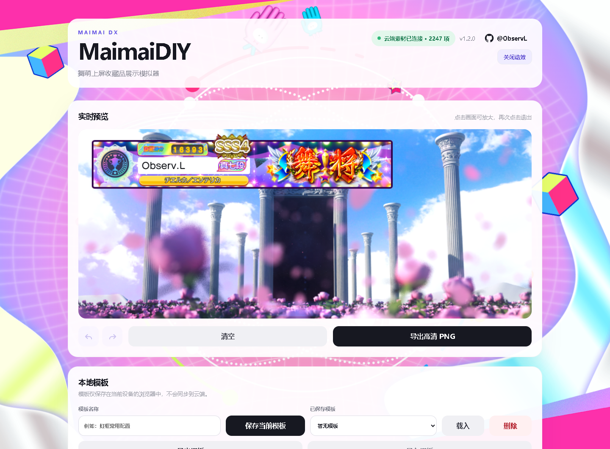
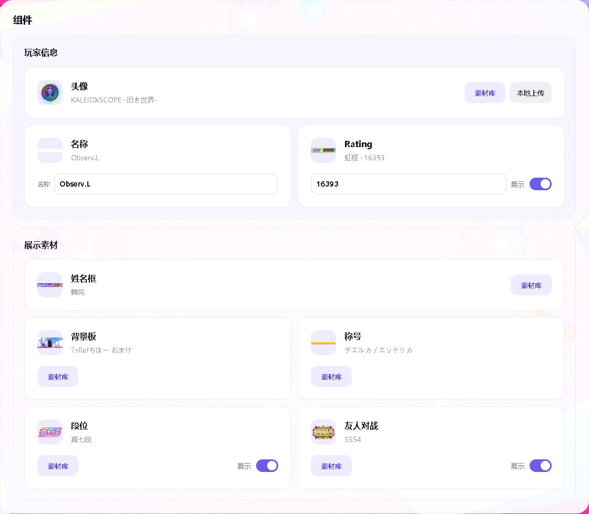
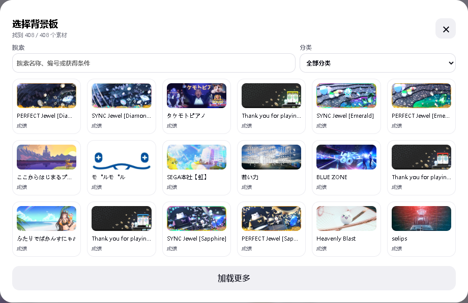
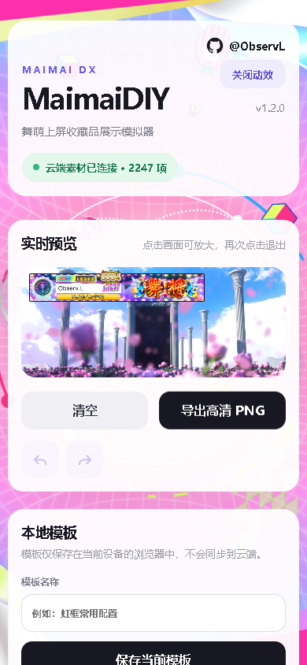
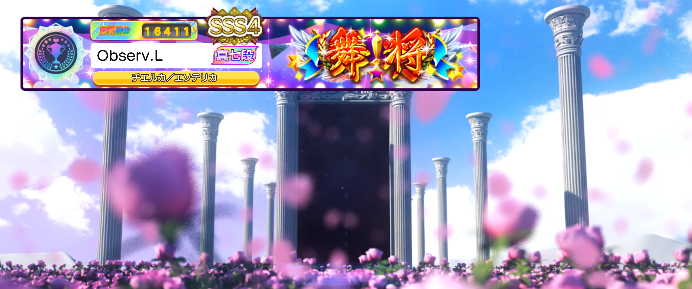

# MaimaiDIY · 舞萌上屏收藏品展示模拟器

当前版本：[**v1.2.1**](https://github.com/Observl/MaimaiDIY/releases/tag/v1.2.1) · 作者：[@ObservL](https://github.com/ObservL)

在浏览器中搭配舞萌收藏品：选择背景板、姓名框、头像、称号、段位与友人对战标识，输入名称和 Rating，实时预览并导出 2160 × 904 高清 PNG。支持电脑与手机，无需安装。

**在线使用：<https://observl.github.io/MaimaiDIY/>**

## 主要功能

- **高清成图**：按模板位置与层级合成，平滑渲染文字和图片，导出 2160 × 904 PNG。
- **素材库**：支持选择背景板、姓名框、头像、称号、段位和友人对战标识，按名称、编号、获得条件搜索，或通过分类筛选。
- **名称与 Rating 输入**：名称直接输入；输入 Rating 数字后，白、蓝、绿、橙、红、紫、铜、银、金、白金、虹框会自动匹配。
- **显示控制**：Rating、段位和友人对战可以隐藏；姓名框、头像、称号和名称始终显示，可更换素材或修改内容。
- **头像本地上传**：只有头像支持本地上传，必须为 1:1 正方形且宽、高均不超过 720 像素。文件只在当前浏览器处理，不会上传至服务器。
- **个人模板**：可为当前配置命名并保存在浏览器中，随后一键载入或删除；也可导出或导入 JSON 模板文件，在不同设备间迁移完整配置。
- **撤回与重做**：通过预览区下方的图标按钮恢复最近操作，最多保留 5 次历史状态。
- **大屏预览**：点击预览区域打开大屏，再次点击或按 Esc 退出；电脑与手机均保持横向画布比例。
- **素材缩略图**：组件图标显示当前使用的素材，替换素材后同步更新。
- **加载与缓存**：素材库分批加载，已验证的图片在浏览器中复用，减少重复下载；加载失败的图片不会当作有效图片保存。
- **动态背景**：CiRCLE 背景适配电脑与手机，采用全屏展示。GitHub 链接下方可开启或关闭动效，刷新后保留选择；网页背景不会进入导出成图。

### 玩家信息与展示素材

头像、名称和 Rating 集中在“玩家信息”中；姓名框、背景板、称号、段位与友人对战位于“展示素材”中。每项组件以当前素材的缩略图展示，方便核对搭配。

### 搜索与筛选

素材库顶部固定搜索和分类控件。素材按类目、素材 ID 排序，友人对战按等级排列；缩略图保留素材比例，每批加载 18 项。

### 手机端

手机页面自适应排版，预览画布保持横向比例。点击预览可放大查看，再次点击退出。

## 使用方法

1. 打开[在线编辑器](https://observl.github.io/MaimaiDIY/)，页面会自动载入默认个人模板。
2. 在“玩家信息”中更换头像，输入名称与 Rating；在“展示素材”中选择姓名框、背景板、称号、段位与友人对战素材。
3. 直接输入名称与 Rating；Rating 框会随数值自动变化。
4. 按需关闭 Rating、段位或友人对战的“显示”开关。
5. 如需使用自定义头像，点击头像行的“本地上传”，选择符合尺寸要求的图片。
6. 在“本地模板”中填写模板名称并保存，或通过“导出模板 / 导入模板”备份和迁移 JSON 文件。
7. 如需回退刚才的修改，点击预览区下方的撤回或重做图标。
8. 点击“导出高清 PNG”，下载 2160 × 904 的完整成图。

点击预览图片即可进入大屏，再次点击画面或按 Esc 退出。电脑和手机均保持 1080:452 的横向比例，手机横向握持可获得更大的查看面积。

模板文件保存组件选择、名称、Rating、显示开关和模板名称；PNG 用于分享最终成图。本地模板仅保存在当前设备的浏览器中，不会同步到云端，清除浏览器数据前可通过“导出模板”备份。

“清空”按钮可切换至初始素材搭配，同时将 Rating 设为 0、名称设为 GUEST。进入页面时仍加载展示用默认搭配。名称最多支持八个可见字符，超长输入会提示并停止更新名称预览。

## 支持项目

MaimaiDIY 由个人维护。如果这个工具对你有帮助，可以自愿赞赏，支持素材存储、网站流量和服务器维护。赞赏不会影响网站任何功能的使用。

赞赏区域位于模拟器页面最下方，无需跳转。

## 版权说明

本项目为非官方的玩家创作工具，与 SEGA 无隶属或授权关系。游戏名称、图片及相关素材的权利归各自权利人所有，请勿将素材用于商业用途。

该网站向所有访客开放，若您通过付费渠道进入该网站，请在对应平台投诉并申请退款。

友人对战和段位徽章包含来自 `@mai-kit/assets` 的 MIT 许可资源，许可文本见 `licenses/mai-kit-assets-LICENSE.txt`。

## 网站访问趋势

统计来自网站的 GoatCounter 访问记录，每日自动更新，展示最近 30 个完整 UTC 日期。这里显示的是网站访问次数（GoatCounter visits），不是 GitHub 仓库浏览量；同一会话的重复访问可能被合并。统计从接入日起积累，更早的日期没有采集记录。
