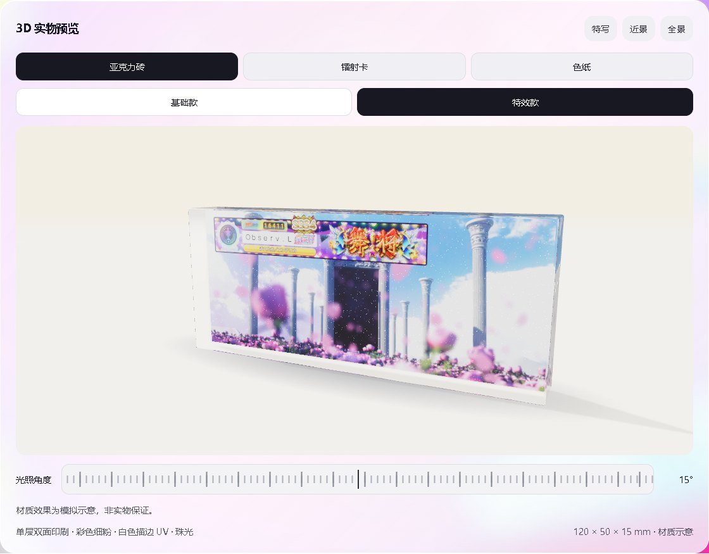
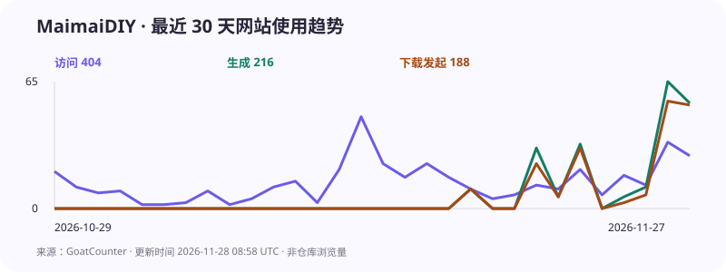

# MaimaiDIY · 舞萌上屏收藏品展示模拟器

在浏览器里搭配国服和日服的舞萌收藏品，实时预览并导出 **2160 × 904 PNG**。支持电脑和手机，无需安装。

**[打开在线编辑器](https://observl.github.io/MaimaiDIY/)** · [3D 周边预览](https://observl.github.io/MaimaiDIY/custom-order.html) · [MaimaiDIY v1.4.0 更新公告](https://github.com/Observl/MaimaiDIY/releases/tag/v1.4.0) · [@ObservL](https://github.com/ObservL)


## 界面与使用方法

1. **选择区服。** 用页眉的展示板按钮切换国服与日服。素材加载成功后，页眉显示当前区服和素材更新时间。旁边的动效按钮控制网页背景动画。
2. **搭配收藏品。** 展开「自定义组件」，在「玩家信息」中设置头像、名称与 Rating，在「展示素材」中更换姓名框、背景板、称号、段位和友人对战标识。Rating 框随数值匹配，Rating、段位和友人对战可单独隐藏。
3. **选择上屏模块。** 在「仅收藏品」「旅行伙伴」「歌曲达成率」之间切换。旅行伙伴可挑选一位队长和最多四位队员并设定等级。歌曲达成率可选择歌曲、谱面类型和难度，再输入达成率。在实时预览中点击曲绘也可打开曲库。
4. **检查并导出。** 用「放大预览」查看全画面，用旁边的刷新按钮重新获取素材并渲染。预览下方提供撤回、重做和「导出高清 PNG」。超长称号会在实时预览中滚动，静态 PNG 只记录一帧。iPhone 和 iPad 可按页面提示存到相册或文件。
5. **保存搭配。** 在「本地模板」中命名保存，可再次载入、删除，或用 JSON 文件导入和导出。模板保存在当前浏览器，换设备或清理浏览器数据前可先导出备份。

素材库支持按名称、编号及已有的获得条件搜索，也可按分类筛选。国服头像、姓名框、背景板与称号的目录和分类来自[落雪查分器公共 API](https://maimai.lxns.net/docs/api/maimai)，所选素材图片仍从腾讯云 COS 加载。组件卡片会显示当前素材的缩略图。头像支持上传 1:1 的图片，最大 **720 × 720** 像素，文件在浏览器内处理。

## 3D 周边预览

从编辑器完成搭配后，打开[定制周边页](https://observl.github.io/MaimaiDIY/custom-order.html)查看当前设计在亚克力砖、镭射卡或色纸上的效果。可旋转模型、切换特写／近景／全景、切换款式并拖动光照角度。模型上的设计使用静态画面，超长称号固定在第一帧。材质效果为模拟示意。



GitHub Pages 公开版提供设计编辑和 3D 预览。在线下单、支付和订单管理目前未在公开版开放。

## 支持项目与反馈

首页底部的「支持项目持续运行」区域提供赞赏二维码和「提交网站反馈」入口。赞赏用于支持素材存储、网站流量和服务维护，完全自愿。

反馈表单支持「网站问题」和「改进建议」。腾讯云上的反馈接口已接入 GitHub Pages，邮件投递待完成云端密钥和持久存储配置。 [反馈服务部署说明](docs/feedback-deployment.md)

## 本地开发

需要 Git 和 Node.js 22.13+。在仓库根目录执行：

```sh
npm ci
npm run build
npm run dev
```

打开 [本地预览](http://127.0.0.1:4173/)。素材库按区服与分类从腾讯云 COS 按需加载，浏览器会复用已校验的缓存。修改后重新运行 `npm run build` 更新预览，使用 `npm run check` 运行代码检查、单元测试和构建。

## 版权说明

MaimaiDIY 是非官方玩家工具，与 SEGA 无隶属或授权关系。游戏名称、图片及相关素材的权利归各自权利人所有，请勿将素材用于商业用途。

Rating 数字使用 Roboto ExtraBold 字形近似呈现，许可见 [SIL OFL 1.1](licenses/Roboto-OFL.txt)。部分友人对战和段位徽章来自 `@mai-kit/assets`，许可见 [MIT 许可](licenses/mai-kit-assets-LICENSE.txt)。

网站免费开放。如果你通过付费渠道进入本站，请向对应平台申请退款。

## 网站访问趋势



图表来自 GoatCounter，每日更新，按 UTC 统计最近 30 个完整日的访问、文件生成及下载发起次数。生成与下载统计包含高清 PNG 和定制设计 ZIP，从上线后开始记录。系统相册长按保存和分享菜单的保存结果无法由网页统计。
