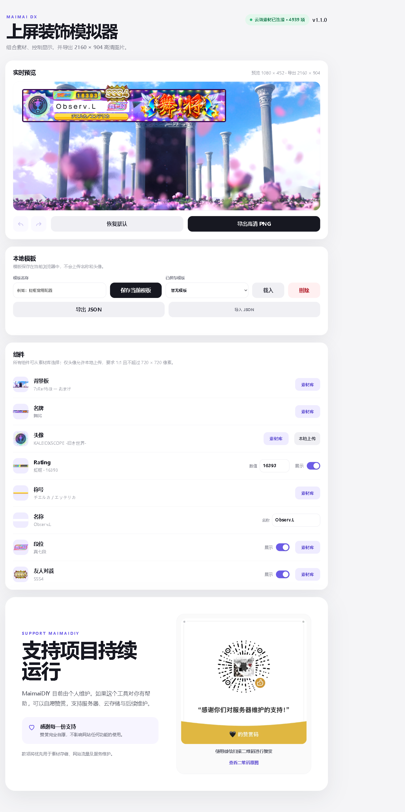

# MaimaiDIY · 舞萌 DX 上屏装饰模拟器

当前版本：**v1.0.1**

在浏览器中组合舞萌 DX 玩家信息区：选择背景板、名牌、头像、称号、段位与友人对战标识，输入名称和 Rating，实时预览并导出 1080 × 452 PNG。

**在线使用：<https://observl.github.io/MaimaiDIY/>**

## 主要功能

- **实时合成**：使用 Canvas 按原始 PSD 坐标与层级渲染，预览尺寸和导出尺寸均为 1080 × 452。
- **素材库**：支持为背景板、名牌、头像、称号、段位和友人对战标识选择素材。
- **分类与搜索**：素材可按游戏内名称、编号、获得条件或分类搜索；背景板、名牌、头像、称号、段位和友人对战均有对应分类。
- **名称与 Rating 输入**：名称直接输入；输入 Rating 数字后，白、蓝、绿、橙、红、紫、铜、银、金、白金、虹框会自动匹配。
- **显示控制**：Rating、段位和友人对战可以隐藏；名牌、头像、称号和名称始终显示，但可以替换。
- **头像本地上传**：只有头像支持本地上传，必须为 1:1 正方形且宽、高均不超过 720 像素。文件只在当前浏览器处理，不会上传至服务器。
- **个人模板**：可为当前配置命名并保存在浏览器中，随后一键载入或删除。
- **撤回与重做**：通过预览区下方的图标按钮恢复最近操作，最多保留 5 次历史状态。
- **高清文字**：名称、Rating 与称号使用森泽 UD 新黑字体进行高分辨率绘制。
- **稳定加载**：已访问内容会在浏览器中缓存，并在加载异常时使用安全回退。

## 使用方法

1. 打开[在线编辑器](https://observl.github.io/MaimaiDIY/)，页面会自动载入默认个人模板。
2. 在“组件”区域点击“素材库”，搜索或筛选需要的背景板、名牌、头像、称号、段位和友人对战素材。
3. 直接输入名称与 Rating；Rating 框会随数值自动变化。
4. 按需关闭 Rating、段位或友人对战的“显示”开关。
5. 如需使用自定义头像，点击头像行的“本地上传”，选择符合尺寸要求的图片。
6. 在“本地模板”中填写名称并保存，方便以后恢复相同搭配。
7. 如需回退刚才的修改，点击预览区下方的撤回或重做图标。
8. 点击“导出 PNG”，下载 1080 × 452 的完整成图。

## 版权说明

本项目为非官方的玩家创作工具，与 SEGA 无隶属或授权关系。游戏名称、图片及相关素材的权利归各自权利人所有，请勿将素材用于商业用途。

友人对战和段位徽章包含来自 `@mai-kit/assets` 的 MIT 许可资源，许可文本见 `licenses/mai-kit-assets-LICENSE.txt`。
