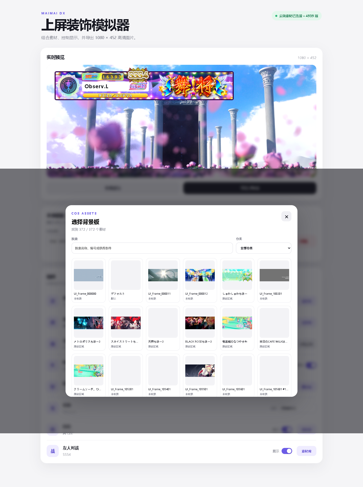

# MaimaiDIY · 舞萌 DX 上屏装饰模拟器

在浏览器中组合舞萌 DX 玩家信息区：选择背景板、名牌、头像、称号、段位与友人对战标识，输入名称和 Rating，实时预览并导出 1080 × 452 PNG。

**在线使用：<https://observl.github.io/MaimaiDIY/>**


## 主要功能

- **实时合成**：使用 Canvas 按原始 PSD 坐标与层级渲染，预览尺寸和导出尺寸均为 1080 × 452。
- **丰富素材库**：当前清单包含 4,939 项素材，覆盖背景板、名牌、头像、称号、Rating 框、段位和友人对战标识。
- **分类与搜索**：素材可按游戏内名称、编号、获得条件或分类搜索；背景板、名牌、头像、称号、段位和友人对战均有对应分类。
- **名称与 Rating 输入**：名称直接输入；输入 Rating 数字后，白、蓝、绿、橙、红、紫、铜、银、金、白金、虹框会自动匹配。
- **显示控制**：Rating、段位和友人对战可以隐藏；名牌、头像、称号和名称始终显示，但可以替换。
- **头像本地上传**：只有头像支持本地上传，必须为 1:1 正方形且宽、高均不超过 720 像素。文件只在当前浏览器处理，不会上传至服务器。
- **个人模板**：可为当前配置命名并保存在浏览器中，随后一键载入或删除。
- **高清文字**：名称、Rating 与称号使用森泽 UD 新黑字体进行高分辨率绘制。
- **离线缓存**：Service Worker 会缓存已访问的素材，减少再次打开素材库时的网络请求；清单保持联网更新。
- **稳定回退**：默认背景随网站发布；云端背景加载超时或失败时自动回退，避免预览整块空白。



## 使用方法

1. 打开[在线编辑器](https://observl.github.io/MaimaiDIY/)，页面会自动载入默认个人模板并请求最新素材清单。
2. 在“组件”区域点击“素材库”，搜索或筛选需要的背景板、名牌、头像、称号、段位和友人对战素材。
3. 直接输入名称与 Rating；Rating 框会随数值自动变化。
4. 按需关闭 Rating、段位或友人对战的“显示”开关。
5. 如需使用自定义头像，点击头像行的“本地上传”，选择符合尺寸要求的图片。
6. 在“本地模板”中填写名称并保存，方便以后恢复相同搭配。
7. 点击“导出 PNG”，下载 1080 × 452 的完整成图。

## 素材与数据

约 700 MB 的完整图片素材存放在腾讯云 COS，网页只按需请求缩略图和当前选中的原图，仓库不重复保存整套资源。

- `materials/manifest.json`：本地素材索引与分类回退清单。
- `materials/titles.json`：从 LXNS 公共接口同步的称号名称、颜色和获得条件。
- `materials/badges.json`：段位与友人对战标识索引。
- `assets/default-background.png`：默认个人模板的本地背景保底资源。
- `sw.js`：浏览器素材缓存策略；素材优先复用缓存，清单优先请求最新版本。

COS 地址与超时设置位于 `app.js` 的 `COS` 配置中。存储桶需要允许来源 `https://observl.github.io` 发起 `GET`、`HEAD` 跨域请求，否则远程图片可能可查看但无法安全导出 Canvas。

## 本地运行

项目是无构建步骤的静态网站。推荐在仓库目录启动任意静态文件服务器，例如：

```powershell
python -m http.server 4173
```

随后访问 <http://127.0.0.1:4173/>。直接双击 `index.html` 也可打开，但浏览器可能限制 Service Worker、跨域请求或字体加载。

## 更新清单

同步 LXNS 称号数据：

```powershell
./tools/sync-lxns-titles.ps1
```

根据本地 `materials` 目录重新生成索引：

```powershell
./tools/build-manifest.ps1
```

生成后应确认每项素材的 `file`、`source`、`name` 与 `group` 字段正确，再上传新增原图到 COS。

## 部署

仓库自带 GitHub Pages 工作流。将 GitHub 仓库的 **Settings → Pages → Source** 设为 **GitHub Actions** 后，推送到 `main` 会自动发布。静态页面部署完成后，浏览器可能短暂保留旧缓存；新版本的缓存名称会自动清理旧资源。

## 版权说明

本项目为非官方的玩家创作工具，与 SEGA 无隶属或授权关系。游戏名称、图片及相关素材的权利归各自权利人所有，请勿将素材用于商业用途。

友人对战和段位徽章包含来自 `@mai-kit/assets` 的 MIT 许可资源，许可文本见 `licenses/mai-kit-assets-LICENSE.txt`。
