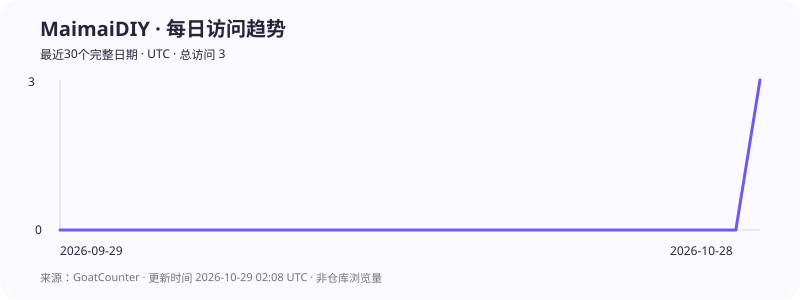

# MaimaiDIY · 舞萌 DX 上屏装饰模拟器

当前版本：**v1.1.2** · 作者：[@ObservL](https://github.com/ObservL)

在浏览器中组合舞萌 DX 玩家信息区：选择背景板、名牌、头像、称号、段位与友人对战标识，输入名称和 Rating，实时预览并导出 2160 × 904 PNG。

**在线使用：<https://observl.github.io/MaimaiDIY/>**

## 主要功能

- **高清合成**：使用 Canvas 按原始 PSD 坐标与层级渲染，内部以 4 倍精度合成，平滑缩小并导出 2160 × 904 PNG。
- **素材库**：支持为背景板、名牌、头像、称号、段位和友人对战标识选择素材。
- **分类与搜索**：素材可按游戏内名称、编号、获得条件或分类搜索；背景板、名牌、头像、称号、段位和友人对战均有对应分类。
- **名称与 Rating 输入**：名称直接输入；输入 Rating 数字后，白、蓝、绿、橙、红、紫、铜、银、金、白金、虹框会自动匹配。
- **显示控制**：Rating、段位和友人对战可以隐藏；名牌、头像、称号和名称始终显示，但可以替换。
- **头像本地上传**：只有头像支持本地上传，必须为 1:1 正方形且宽、高均不超过 720 像素。文件只在当前浏览器处理，不会上传至服务器。
- **个人模板**：可为当前配置命名并保存在浏览器中，随后一键载入或删除；也可导出或导入 JSON 模板文件，在不同设备间迁移完整配置。
- **撤回与重做**：通过预览区下方的图标按钮恢复最近操作，最多保留 5 次历史状态。
- **平滑文字**：名称、Rating 与称号使用 SEGA 丸 Gothic 字体，经高分辨率合成与平滑缩小输出。
- **大屏预览**：点击预览区域打开大屏，再次点击或按 Esc 退出；电脑与手机均保持横向画布比例。
- **素材缩略图**：组件图标显示当前使用的素材，替换素材后同步更新。
- **稳定加载**：已访问内容会在浏览器中缓存，并在加载异常时使用安全回退。

## 使用方法

1. 打开[在线编辑器](https://observl.github.io/MaimaiDIY/)，页面会自动载入默认个人模板。
2. 在“组件”区域点击“素材库”，搜索或筛选需要的背景板、名牌、头像、称号、段位和友人对战素材。
3. 直接输入名称与 Rating；Rating 框会随数值自动变化。
4. 按需关闭 Rating、段位或友人对战的“显示”开关。
5. 如需使用自定义头像，点击头像行的“本地上传”，选择符合尺寸要求的图片。
6. 在“本地模板”中填写名称并保存，或通过“导出 JSON / 导入 JSON”备份和迁移模板。JSON 包含模板名称及全部组件设置。
7. 如需回退刚才的修改，点击预览区下方的撤回或重做图标。
8. 点击“导出高清 PNG”，下载 2160 × 904 的完整成图。

点击预览图片即可进入大屏，再次点击画面或按 Esc 退出。电脑和手机均保持 1080:452 的横向比例，手机横向握持可获得更大的查看面积。

“导出 JSON”和“导入 JSON”在模板区居中并排显示。模板文件用于保存组件选择、名称、Rating、显示开关和模板名称；PNG 用于分享最终成图。浏览器保存的模板仅存在于当前设备，清除浏览器数据前请先导出 JSON 备份。

“清空”按钮可切换至初始素材搭配，同时将 Rating 设为 0、名称设为 GUEST。进入页面时仍加载展示用默认搭配。名称最多支持八个可见字符，超长输入会提示并停止更新名称预览。

素材库支持固定搜索与筛选、按类目和素材 ID 排序、自然比例缩略图及每批 18 项增量加载。已验证的图片可在当前浏览器复用缓存，减少重复下载。

## 支持项目

MaimaiDIY 由个人维护。如果这个工具对你有帮助，可以自愿赞赏，支持素材存储、网站流量和服务器维护。赞赏不会影响网站任何功能的使用。

赞赏区域位于模拟器页面最下方，无需跳转。

## 版权说明

本项目为非官方的玩家创作工具，与 SEGA 无隶属或授权关系。游戏名称、图片及相关素材的权利归各自权利人所有，请勿将素材用于商业用途。

友人对战和段位徽章包含来自 `@mai-kit/assets` 的 MIT 许可资源，许可文本见 `licenses/mai-kit-assets-LICENSE.txt`。

## 网站访问趋势

统计来自网站的 GoatCounter 访问记录，每日自动更新，展示最近 30 个完整 UTC 日期。这里显示的是网站访问次数（GoatCounter visits），不是 GitHub 仓库浏览量；同一会话的重复访问可能被合并。统计从接入日起积累，更早的日期没有采集记录。
